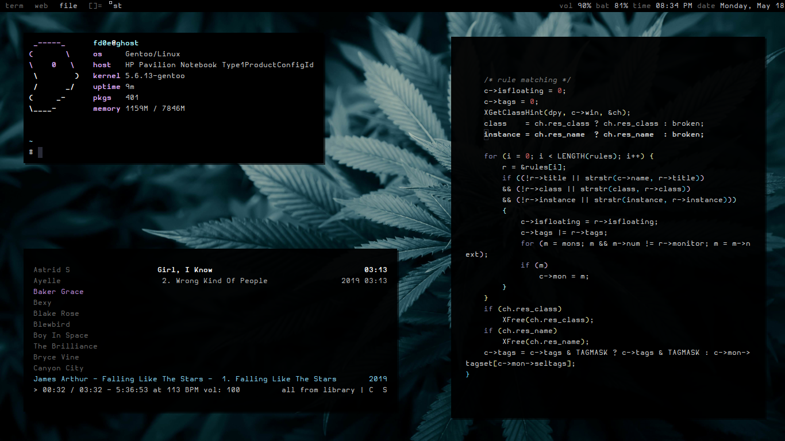

# dotfiles
dotfiles of my linux setup. Feel free to use it.



For my suckless configs - [suckless](https://github.com/sh-ubh/suckless)

# To replicate
```shell
$ git clone https://github.com/sh-ubh/dotfiles.git
$ sudo pacman -S stow (use your choice of package manager)
$ cd dotfiles
$ stow <package>
```
That's all
